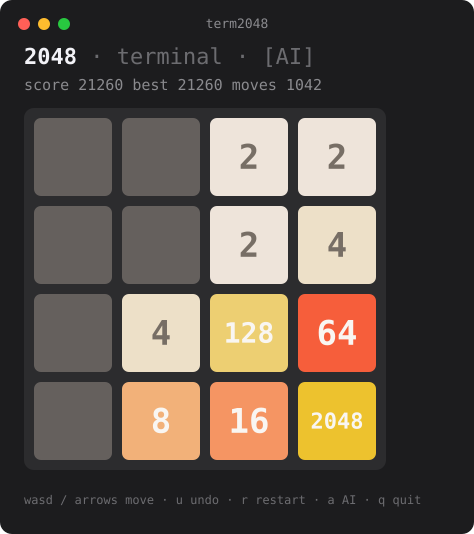

# term2048

[](https://github.com/pastbologanesh0101/term2048/actions/workflows/ci.yml)
[](./LICENSE)


The **2048** sliding-tile game in your terminal — zero runtime dependencies, 24-bit
colour, and a built-in **expectimax AI** that you can hand the controls to at any
time.

**▶ Play in the browser: https://term2048.vercel.app** — same `game.ts` + `ai.ts`,
a DOM front-end (`web/`).



## Run it

Requires Node.js 18+.

```bash
git clone https://github.com/pastbologanesh0101/term2048.git
cd term2048
npm install
npm run build
node dist/cli.js          # play
node dist/cli.js --ai     # sit back and watch the AI
```

Or without cloning, once published:

```bash
npx term2048
```

### Controls

| Key | Action | | Key | Action |
| --- | --- | --- | --- | --- |
| `←↑→↓` / `wasd` / `hjkl` | move | | `u` | undo |
| `a` | toggle the AI | | `r` | restart |
| `space` | keep playing after a win | | `q` / `Ctrl-C` | quit |

Your best score per board size is remembered in `~/.term2048.json`.

### Flags

```
--size <n>      board side length (default 4)
--target <n>    winning tile (default 2048)
--seed <n>      fixed RNG seed — reproducible game
--ai            start with the AI driving
--depth <n>     force a fixed AI search depth
--headless <n>  no UI: let the AI play n games and print a summary
```

## The AI

`node dist/cli.js --headless 24` plays entire games on its own. A recent run:

```
24 games · reached 2048: 16 (67%) · avg score 29,271
best tile: 1024×8  2048×14  4096×2
```

It's **expectimax**: the move you make is a max node, the tile the game drops next
is a chance node (every empty cell × `{2: 0.9, 4: 0.1}`), and leaves are scored by
a weighted sum of *free cells*, *monotonicity* (rows/columns that stay ordered),
*smoothness* (neighbouring tiles close in value), and *keeping the largest tile in
a corner*. Search depth adapts to how full the board is (3 when crowded, up to 5
when there's room), so a full game still finishes in about a second.

`npm run bench -- 30` runs your own sample.

## Library

The game and the AI are plain functions with no I/O — drop them into anything:

```ts
import { newGame, move, bestMove, render } from "term2048";

let state = newGame({ seed: 42 });
while (state.status === "playing") {
  const dir = bestMove(state.grid);
  if (!dir) break;
  state = move(state, dir).state;
}
console.log(render(state)); // final board as a string
```

| Export | |
| --- | --- |
| `newGame(opts?)` | fresh `GameState` with two tiles; `opts.seed` makes it reproducible |
| `move(state, dir)` | `{ state, changed, spawn }` — slides, spawns a tile, updates status |
| `slide(grid, dir)` | pure board slide, no spawn (the testable core) |
| `legalMoves(grid)` | directions that would change the board |
| `bestMove(grid, opts?)` | the AI's chosen direction, or `null` if stuck |
| `heuristic(grid)` | static board evaluation used by the search |
| `render(state, opts?)` | board → printable string (colour unless `NO_COLOR`) |

Every `move` returns a new state, so undo is just a stack of past states.

## Project layout

```
src/
  game.ts    rules: slide/merge, spawn (seedable RNG), win/lose, no I/O
  ai.ts      expectimax search + board heuristic
  render.ts  GameState -> string, 24-bit colour tiles
  tui.ts     raw-mode key loop, undo stack, best-score file, AI autoplay
  cli.ts     flag parsing; interactive or --headless
test/
  game.test.ts   slide/merge edge cases, spawn counting, status, determinism
  ai.test.ts     heuristic ordering, forced moves, a seeded game reaching 512+
web/
  index.html + main.ts + style.css   browser front-end (Vite), imports src/ as-is
```

## Development

```bash
npm run dev        # play straight from source (tsx)
npm test           # vitest
npm run typecheck  # tsc --noEmit, strict
npm run build      # tsup -> dist/ (ESM + d.ts)
npm run bench -- 30
```

CI runs type-check, tests, build and a 3-game AI run on Node 18, 20 and 22.

## License

MIT © pastbologanesh0101
